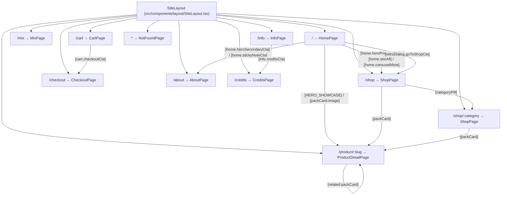

# SITE_LAYOUT.md — Yapı, Tasarım ve Yerleşim Haritası

> Bu doküman `src/`, `src/content/copy.ts`, `src/data/products.js`, `src/styles/tokens*.css`, `src/index.css`, `index.html`, `public/` ve `package.json` dosyalarındaki **gerçek uygulama kodu** okunarak güncellenmiştir. Wireframe ve yerleşim açıklamalarında ekranda görünen metinler yerine `src/content/copy.ts` anahtarlarıyla uyumlu `[anahtar]` yer tutucuları kullanılmıştır.

---

## 1. Site Özeti

- **Marka Adı:** `[site.brandName]` (`index.html` `<title>`, `og:site_name` ve `src/content/copy.ts` → `COPY.site.brandName`)
- **Amaç:** 6 farklı ambalaj kategorisindeki 24 şekerleme ve atıştırmalık poşetini sergileyen; 50 g porsiyonlu 4–6 çeşit "Kendi Poşetini Doldur" (`/mix`) deneyimi, Fuse.js fuzzy arama, favori listesi, URL senkronlu mağaza filtreleri, yerel sepet/demo ödeme akışı ve Wikimedia Commons görsel atıf sayfası (`/credits`) sunan etkileşimli e-ticaret vitrin demosu.
- **Hedef Kitle:** Sert şeker, yumuşak jelibon, çikolata kaplı draje, lolipop/sakız, geleneksel lokum/akide ve tuzlu çıtır atıştırmalık seven son tüketiciler.
- **Ton:** Yüksek kontrastlı pop-ambalaj estetiği (kalın kakao-bordo konturlar `#2B1410`, blursız sert pop gölgeler, ısı yapıştırmalı poşet zikzakları, yıldız patlaması fiyat rozetleri ve retro OS pencere metaforu).
- **SEO & Meta Varlıkları:**
  - `index.html`: `lang="tr"`, `theme-color="#FFF8EE"`, `canonical` (`https://lupuk.com.tr/`), Open Graph (`og:type`, `og:locale="tr_TR"`, `og:image="https://lupuk.com.tr/og-image.png"` 1200×630) ve `twitter:card="summary_large_image"`.
  - `public/og-image.png`: Sosyal paylaşım önizleme görseli.
  - `public/robots.txt`: Tüm tarayıcılara izin (`Allow: /`) ve `Sitemap: https://lupuk.com.tr/sitemap.xml`.
  - `public/sitemap.xml`: Ana statik rotalar (`https://lupuk.com.tr/` altında `/`, `/shop`, 6 `/shop/:category`, `/mix`, `/about`, `/info`, `/credits`).
  - `public/brand/`: `logo-horizontal.svg`, `logo-main.svg`, `logo-mark.svg` (favicon), `logo-mono.svg`.
  - `public/` ikon & manifest: `favicon-32x32.png`, `apple-touch-icon.png`, `icon-192.png`, `icon-512.png`, `site.webmanifest`.

---

## 2. Site Haritası

### 2.1. Rota Ağacı (ASCII)

```text
SiteLayout (src/components/layout/SiteLayout.tsx)
├── /                     → HomePage
├── /shop                 → ShopPage (?q=, ?min=, ?max=, ?sort=, ?fav=1 destekli)
├── /shop/:category       → ShopPage (kategori slug filtresi + URL query parametreleri)
├── /mix                  → MixPage (4–6 çeşit, her biri 50g porsiyon özel karışım poşeti)
├── /product/:slug        → ProductDetailPage
├── /cart                 → CartPage
├── /checkout             → CheckoutPage (demo form doğrulama & onay)
├── /about                → AboutPage
├── /info                 → InfoPage
├── /credits              → CreditsPage (Wikimedia Commons görsel lisans atıfları)
└── *                     → NotFoundPage (404)
```

### 2.2. Rota Ağacı (Mermaid)



### 2.3. Rota Envanter Tablosu

| Rota | Sayfa Bileşeni | Dosya Yolu | Amaç | Kullandığı Veri / Store | Erişildiği Yerler |
| :--- | :--- | :--- | :--- | :--- | :--- |
| `/` | `HomePage` | `src/pages/HomePage.tsx` | Ana vitrin: hero, ticker, kategori sekmeleri, öne çıkanlar karuseli, dama bandı ve retro diyalog + tezgâh notu | `products`, `getCategories()`, `getProductsByCategory()`, `SITE_CONFIG`, `COPY.home` | `Header` (logo), `ProductDetailPage` (breadcrumb), `NotFoundPage` |
| `/shop` | `ShopPage` | `src/pages/ShopPage.tsx` | Tüm ürünleri listeleme; URL senkronlu Fuse.js arama (`?q=`), fiyat slider (`?min=&max=`), sıralama (`?sort=`) ve favori filtresi (`?fav=1`) | `products`, `getCategories()`, `useProductSearch`, `useCartStore` (`favorites`), `COPY.shop` | `Header` (nav, arama submit, favori sayacı), `Footer`, `HomePage`, `CartDrawer`, `CartPage`, `CheckoutPage`, `AboutPage`, `ProductDetailPage`, `NotFoundPage` |
| `/shop/:category` | `ShopPage` | `src/pages/ShopPage.tsx` | Seçili kategori slug'ına göre filtrelenmiş mağaza vitrini | `products`, `getCategories()`, `getCategoryBySlug()`, `useProductSearch`, `useCartStore` | `Footer` (kategori linkleri), `ShopPage` (kategori hapları), `AboutPage` (6 renk kartı), `ProductDetailPage` (breadcrumb) |
| `/mix` | `MixPage` | `src/pages/MixPage.tsx` | 50 g porsiyon kuralıyla 4–6 çeşit (200–300 g) özel karışım poşeti oluşturma (`lolipop-sakiz` hariç 20 ürün) | `products`, `getCategories()`, `getCategoryBySlug()`, `useCartStore` (`addCustomMix`), `COPY.mix` | `Header` (Masaüstü & Mobil nav) |
| `/product/:slug` | `ProductDetailPage` | `src/pages/ProductDetailPage.tsx` | Ürün detayı, aroma/seçenek seçimi, adet, ürün etiketi, akordeonlar ve benzer ürünler | `getProductBySlug()`, `getCategoryBySlug()`, `getRelatedProducts()`, `useCartStore` (`ekle`, `favorites`, `toggleFavorite`), `COPY.pdp` | `PackCard`, `HomePage` (hero vitrin), `Header` (arama modalı sonuçları), `CartDrawer`, `CartPage` |
| `/cart` | `CartPage` | `src/pages/CartPage.tsx` | Sepet listesi, adet artırma/azaltma/silme, fiş özeti ve ödemeye geçiş | `useCartStore` (`items`, `artir`, `azalt`, `sil`, `temizle`, `selectTotalItems`, `selectSubtotal`), `COPY.cart` | `Footer`, `CartDrawer` |
| `/checkout` | `CheckoutPage` | `src/pages/CheckoutPage.tsx` | Demo teslimat adresi formu doğrulaması ve konfetili demo sipariş onay ekranı | `useCartStore` (`items`, `selectSubtotal`, `temizle`), `triggerAddToCartConfetti`, `COPY.checkout` | `CartDrawer`, `CartPage` |
| `/about` | `AboutPage` | `src/pages/AboutPage.tsx` | Marka hikâyesi, defter ızgaralı vitrin ve 6 sabit ambalaj rengi rehberi | `getCategories()`, `COPY.about` | `Header` (nav), `Footer`, `HomePage` (hero ikincil CTA & tezgâh notu) |
| `/info` | `InfoPage` | `src/pages/InfoPage.tsx` | Teslimat/iade özet kartları, SSS akordeonu ve `/credits` bağlantısı | `COPY.info` | `Header` (nav), `Footer` |
| `/credits` | `CreditsPage` | `src/pages/CreditsPage.tsx` | Katalogdaki 16 Wikimedia Commons görseli için yazar, dosya, lisans ve düzenleme atıf kartları | `COPY.credits` | `Footer`, `InfoPage` (`[info.creditsCta]`) |
| `*` | `NotFoundPage` | `src/pages/NotFoundPage.tsx` | Eşleşmeyen rotalar için 404 hata kartı | `COPY.notFound` | Geçersiz tüm URL'ler |

### 2.4. Ana Kullanıcı Akışları

1. **Alışveriş Akışı:**
   `/` (`HomePage`) → `/shop` veya `/shop/:category` (`ShopPage`) → `/product/:slug` (`ProductDetailPage`) veya doğrudan `PackCard` üzerinden `[packCard.addToCartAria]` → `CartDrawer` (otomatik açılır) → `/cart` (`CartPage`) veya doğrudan `/checkout` (`CheckoutPage`).
2. **Kendi Poşetini Doldur Akışı:**
   `Header` `[header.navLinks.mix]` → `/mix` (`MixPage`) → Kategori filtresi seçimi (5 uygun kategori) → 4–6 arası ürün seçimi (her biri 50 g porsiyon) → `[mix.addMixToCart]` → `useCartStore.addCustomMix()` → `CartDrawer` açılır → `/cart` veya `/checkout`.
3. **Arama ve URL Senkronlu Filtre Akışı:**
   - **Global Arama Modalı:** `Header` `[header.searchTriggerAria]` → Radix `Dialog` açılır → anlık `Fuse.js` ilk 5 sonuç (`/product/:slug` bağlantısı) veya form submit ile `/shop?q=...` yönlendirmesi.
   - **Mağaza İçi Filtreleme:** `/shop` üzerinde arama inputu (`?q=`) + Radix `Slider` fiyat aralığı (`?min=&max=`) + Radix `Select` sıralama (`?sort=`) + kategori hapları (`/shop/:category`) + favori filtresi (`?fav=1`).
4. **404 Akışı:**
   Tanımsız rota (`*`) → `NotFoundPage` (`/` veya `/shop` yönlendirme butonları). Olmayan ürün slug'ı (`/product/olmayan-slug`) → `ProductDetailPage` içinde `EmptyStateIllustration` (`torn-bag`) içeren inline boş durum kartı.

---

## 3. Global Kabuk (`SiteLayout`)

`src/components/layout/SiteLayout.tsx` tüm rotaları şu dikey flex yapısıyla sarmalar:
- Kök kapsayıcı: `min-h-svh flex flex-col bg-[var(--bg-page)] text-[var(--text-primary)]`
- İlk odaklanabilir öğe: `<a href="#main-content" className="sr-only focus:not-sr-only ...">[common.skipToContent]</a>` (klavye ile odaklandığında sol üstte hap rozet olarak görünür)
- Çocuk sırası: `<Header />` → `<main id="main-content" className="flex-1"><Outlet /></main>` → `<Footer />` → `<CartDrawer />`
- Not: `TickerStrip` global kabukta değil, yalnızca `HomePage` içinde Bölüm 2 olarak yer alır.

### 3.1. `Header` (`src/components/layout/Header.tsx`)

Sticky (`sticky top-0 z-[var(--z-sticky)]`), üstten yüzen gölgesiz hap çubuk (`h-16 rounded-full pop-border bg-[var(--color-cream-alt)]`). `320px` dar mobil ekranlara uyum için dış boşluklar `px-2 min-[360px]:px-4`, iç boşluklar `px-2.5 min-[360px]:px-4 sm:px-6`, logo `h-7 min-[360px]:h-8 sm:h-10 w-auto` ve sağ aksiyon aralığı `gap-1 min-[360px]:gap-1.5 sm:gap-2` olarak kademelendirilmiştir. Favori ve sepet butonlarında görünür ikon + sayı korunurken ekran okuyucu bağlamı `sr-only` metin parçalarıyla (`<span className="sr-only">Favorilerim (</span>...<span className="sr-only"> ürün)</span>` ve `<span className="sr-only">Sepeti aç (</span>...<span className="sr-only"> ürün)</span>`) sağlanır.

**Masaüstü (`md` ve üzeri):**
```text
+---------------------------------------------------------------------------------------------------+
| [logo-horizontal.svg]   [navLinks.shop] [navLinks.mix] [navLinks.about] [navLinks.info]  [🔍][♥N][🛍N] |
+---------------------------------------------------------------------------------------------------+
```

**Mobil (`< md`):**
```text
+---------------------------------------------------------------+
| [logo-horizontal.svg]              [🔍] [♥ N] [🛍 N] [☰]      |
+---------------------------------------------------------------+
```
- Mobil menü (`md:hidden`) inline açılır div yerine **Radix `Dialog`** (`Dialog.Root` → `Dialog.Portal` → `Dialog.Overlay` + `Dialog.Content`) olarak çalışır; böylece `Esc` tuşu, odak tuzağı (focus trap) ve `[header.mobileNavAria]` erişilebilir başlığı sağlanır:
```text
+---------------------------------------------------------------+
| [header.mobileNavAria]                                    [✕] |
| [navLinks.shop]                                               |
| [navLinks.mix]                                                |
| [navLinks.about]                                              |
| [navLinks.info]                                               |
+---------------------------------------------------------------+
```

**Global Arama Modalı (Radix `Dialog`):**
```text
+-----------------------------------------------+
| [header.searchModalTitle]                 [✕] |
| [ input: header.searchPlaceholder ] [submit]  |
| +-------------------------------------------+ |
| | [item.name]  [item.flavor · netWeight] TL | | (ilk 5 Fuse.js sonucu)
| +-------------------------------------------+ |
+-----------------------------------------------+
```
- Katalog boşsa `[header.emptyCatalog]`, sonuç yoksa `[header.noResults]`, form submit edildiğinde `/shop?q=...` rotasına yönlenir. Fiyatlar `formatPrice()` üzerinden `TL` birimiyle gösterilir.

### 3.2. `Footer` (`src/components/layout/Footer.tsx`)

Üst kenarı `border-t-2 border-[var(--color-ink)]`, zemini `bg-[var(--color-cream-alt)]`:
```text
+-------------------------------------------------------------------------------+
| [logo-horizontal.svg]  | [footer.categoriesTitle] | [footer.pagesTitle] | [footer.noteTitle] |
| [footer.description]   | · 6 kategori linki       | · [pages.allProducts]| [site.footerNote]  |
| [site.batchCode]       |   (/shop/:slug)          | · [pages.about]     | [logo-mono.svg]    |
|                        |                          | · [pages.info]      |                    |
|                        |                          | · [pages.cart]      |                    |
|                        |                          | · [pages.credits]   |                    |
+-------------------------------------------------------------------------------+
|                      [footer.wordmark] (dev, alttan %18 kırpılmış)            |
+-------------------------------------------------------------------------------+
```

### 3.3. `CartDrawer` (`src/components/packaging/CartDrawer.tsx`)

Radix `Dialog` ile sağdan açılan (`fixed top-0 right-0 bottom-0 max-w-md`) çekmece (`shadow-[-6px_0_0_#2B1410]`):
- Başlık bandı (`bg-[var(--color-butter)]`): `[cartDrawer.title]` + kapat butonu (`[cartDrawer.closeAria]`).
- Boş durum: `EmptyStateIllustration` (`variant="empty-bag"`) + `[cartDrawer.emptyTitle]` + `[cartDrawer.emptySubtitle]` + `/shop` linki (`[common.goToShop]`).
- Dolu durum: Ürün kartları (`-400.webp` / `srcSet` 400w & 800w görsel, ürün adı linki, `[flavor · netWeight]`, varsa `isCustomMix` alt listesi `[sub.name (sub.weight)]`, satır tutarı, silme ikonu, `-/+` adet kontrolü).
- Alt özet (`items.length > 0`): `[cartDrawer.subtotalLabel]` + tutar, 2 sütunlu CTA (`/cart` `[cartDrawer.goToCart]` ve `/checkout` `[cartDrawer.goToCheckout]`) + `[cartDrawer.clearCart]`.

---

## 4. Sayfa Sayfa, Bölüm Bölüm Yerleşim

### 4.1. `HomePage` (`src/pages/HomePage.tsx`, `/`)

Anti-AI sadeleştirme sonrası `HomePage` **5 ana bölümden** oluşur (eski klasör kartları gridi ve polaroid/takvim bölümü kaldırılmıştır):

1. **Bölüm 1 — Asimetrik 12 Sütun Hero (`lg:grid-cols-12`):**
   - Sol (`lg:col-span-6`): Parti rozeti (`[site.batchCode] · [home.heroBadgeSuffix]`), dev başlık (`--text-hero`: `[home.heroTitleStart]` + serif italik `[home.heroTitleHighlight]` + `[home.heroTitleEnd]`), alt metin (`[home.heroSubtitle]`) ve 2 CTA (`/shop` `[home.heroPrimaryCta]` `pop-shadow`, `/about` kesikli çerçeveli `[home.heroSecondaryCta]`).
   - Sağ (`lg:col-span-6`): `bg-[var(--color-powder-blue)]` + `.halftone-dots` + `pop-shadow-lg` ambalaj vitrini, sağ üstte `-rotate-12` dairesel mühür rozeti (`bg-[var(--color-lime)]`: `[home.sealTop]` / `[home.sealCount]` / `[home.sealBottom]`), üstte `logo-main.svg` + `[home.heroPackCount]` rozeti, altta 3'lü vitrin rafı (`HERO_SHOWCASE`: 3 `/product/:slug` kartı).
2. **Bölüm 2 — Tam Genişlik Kayan Ticker (`TickerStrip`):**
   - `bg-[var(--color-butter)]`, üst-alt `2px` kontur, `[ticker.defaultItems]` kesintisiz döngü + sağda sabit duraklat/oynat kontrol düğmesi (`▶` / `❚❚`).
3. **Bölüm 3 — Tek Kategori Gezintisi (`CategoryTabs`):**
   - Başlık (`[home.categoriesTitle]`) + `[home.seeAll]` (`/shop`) linki.
   - Radix `Tabs` (`tumu` + 6 kategori) → seçili sekmenin ilk 4 ürünü 4 sütunlu `PackCard` ızgarasında (`sm:grid-cols-2 lg:grid-cols-4`).
4. **Bölüm 4 — Tam Genişlik Öne Çıkan Paketler Karuseli (`FeaturedCarousel`):**
   - `lazy()` + `Suspense` (`FeaturedCarouselFallback`) ile yüklenen `src/components/home/FeaturedCarousel.tsx` bileşeni (`bg-[var(--color-cream-alt)] border-y-2 border-[var(--color-ink)]`).
   - Başlık (`[home.carouselTitle]`) + `←` / `→` butonları + `products.filter(p => p.featured).slice(0, 8)` `PackCard` karuseli + ilerleme çubuğu + `[home.carouselMore]` (`/shop`).
5. **Bölüm 5 — Dama Bandı + Retro OS Diyalog & Tezgâh Notu:**
   - Tam genişlik `h-10 pop-checker-band`.
   - Altında 12 sütunlu ofsetli düzen: `lg:col-span-6 lg:col-start-2` içinde `RetroDialog` (`pop-shadow-lg`), `lg:col-span-4` içinde gölgesiz sarı tezgâh notu kartı (`[home.stickyNoteBadge]`, `[home.stickyNoteText]`, `[home.stickyNoteCta]` → `/about`).

### 4.2. `ShopPage` (`src/pages/ShopPage.tsx`, `/shop` ve `/shop/:category`)

```text
+-------------------------------------------------------------------------------+
| [shop.title / currentCategoryObj.name]               [shop.listedCount]       |
| (varsa currentCategoryObj.description)                                        |
+-------------------------------------------------------------------------------+
| [ Arama Inputu (?q=) ]  [ Fiyat Slider (?min=&max=) ]  [ Sıralama (?sort=) ]  |
| [common.all] [6 Kategori Hapı] [shop.favoritesLabel (?fav=1)]                 |
+-------------------------------------------------------------------------------+
| [PackCard]   [PackCard]   [PackCard]   [PackCard]    (4 sütun / 2 / 1)        |
+-------------------------------------------------------------------------------+
```
- **URL Parametre Senkronizasyonu:** `q`, `min`, `max`, `sort` (`featured` | `price-asc` | `price-desc` | `name-asc`) ve `fav=1` parametreleri `useSearchParams(..., { replace: true })` ile çift yönlü senkronize edilir; kategori değişiminde mevcut query parametreleri korunur.
- **Üst Limit:** `maxCatalogPrice` katalogdaki en yüksek fiyattan 50'nin katına yuvarlanarak dinamik hesaplanır (mevcut 24 üründe max fiyat 142 → `150`).
- **Görsel Stil:** Filtre çubuğu ve boş durum kartı gölgesiz düz `pop-border` kullanır.
- **Boş Durum:** `EmptyStateIllustration` (`variant="no-results"`) + `[shop.emptyResultsTitle]` + `[shop.resetFilters]`.

### 4.3. `MixPage` (`src/pages/MixPage.tsx`, `/mix`)

```text
+-------------------------------------------------------------------------------+
| [mix.pageTitle]                                        [mix.badge (50G)]      |
| [mix.subtitle (4–6)]                                                          |
+-------------------------------------------------------------------------------+
| SOL (8 sütun)                              | SAĞ (4 sütun, sticky, ZigzagEdge)|
| [mix.allWithCount] [5 Uygun Kategori Hapı] | [mix.trayTitle]      [mix.reset] |
| +------------+ +------------+ +----------+ | [Bölme #1]           [Zorunlu]   |
| | Ürün Kartı | | Ürün Kartı | | Ürün K.  | | ...                              |
| | 50g pors.  | | 50g pors.  | | 50g pors.| | [Bölme #4]           [Zorunlu]   |
| +------------+ +------------+ +----------+ | [Bölme #5–#6]        [Opsiyonel] |
| [mix.excludedNote]                         | [Seçilen] [Gramaj] [Poşet Tutarı]|
|                                            | [mix.addMixToCart]               |
+-------------------------------------------------------------------------------+
```
- **50 g Porsiyon Kuralı:** `MIN_MIX_ITEMS = 4`, `MAX_MIX_ITEMS = 6`, `PORTION_GRAMS = 50`.
- **Hariç Tutulan Kategori:** `EXCLUDED_MIX_CATEGORY = 'lolipop-sakiz'` (4 ürün hariç tutulur; 5 kategoriden 20 stokta ürün listelenir).
- **Orantılı Fiyat:** `getPortionPrice(product)` = `Math.round((product.price * 50) / (parseInt(product.netWeight, 10) || 100))`.
- **Canlı Özet:** Seçim sayısına göre toplam gramaj `200g–300g` arası güncellenir (`aria-live="polite"`). En az 4 seçim yapılmadan `[mix.addMixToCart]` butonu pasiftir ve `[mix.minSelectionRemaining]` gösterir.

### 4.4. `ProductDetailPage` (`src/pages/ProductDetailPage.tsx`, `/product/:slug`)

- **Breadcrumb:** `flex flex-nowrap items-center gap-2 overflow-x-auto whitespace-nowrap` (`min-h-[44px]` tek satır, yatay kaydırmalı düzen): `[common.home]` / `[common.shop]` / `[category.name]` / `[product.name]`
- **Ana 2 Sütun (`lg:grid-cols-12`):**
  - Bilgi Sütunu (`order-2 lg:order-1`, mobilde görselin altında): `h1` başlık, alt başlık, fiyat, açıklama, varsa `flavors` renkli hap seçicisi, adet (`-/+`) + `[pdp.addToCart]` (`pop-shadow pop-spring`, tıklandığında geçici `'Eklendi'` durumu) + favori kalp butonu, besin etiketi görünümlü bilgi paneli (`[pdp.nutritionTitle]`: `[pdp.batchCodeLabel]`, `[pdp.flavorStripLabel]`, `[pdp.ingredientsLabel]`, `[pdp.allergensLabel]`) ve `h2.sr-only` (`Ürün Ayrıntıları`) altında Radix `Accordion` (3 panel: `[pdp.accordionIngredients]`, `[pdp.accordionAllergens]`, `[pdp.accordionStorage]`).
  - Görsel Sütunu (`order-1 lg:order-2`, mobilde üstte): `ZigzagEdge` + `FlavorStripe` + `NetWeightTag` + kare görsel çerçevesi (`.halftone-dots`, `pop-shadow-lg`, `ProductImage` `priority`) + `StarburstBadge` (`size="lg"`) + çoklu görsel varsa küçük görsel şeridi.
- **Mobil Sabit Alt Çubuk (`lg:hidden fixed bottom-0`):** Fiyat, ürün adı (`truncate`) ve `[pdp.addToCart]` butonu (sayfa altında `pb-24 lg:pb-10` boşluğu bırakılır).
- **Benzer Ürünler:** `[pdp.relatedTitle]` altında `getRelatedProducts(product, 4)` → 4 sütunlu `PackCard` ızgarası.
- **Bulunamayan Ürün:** `EmptyStateIllustration` (`variant="torn-bag"`) + `[pdp.notFoundTitle]` + `[common.backToShop]`.

### 4.5. `CartPage` (`src/pages/CartPage.tsx`, `/cart`)

- Başlık (`[cart.title]`) + `[cart.clearCart]`.
- Boşsa: `EmptyStateIllustration` (`variant="empty-bag"`) + `[common.goToShop]`.
- Doluysa: Sol 8 sütun ürün listesi (`isCustomMix` ise `[common.mixContentsLabel]` altında içerik hapları) + Sağ 4 sütun `ZigzagEdge` üstlü fiş özet kartı (`pop-shadow`, `[cart.receiptTitle]`, `[cart.itemCountLabel]`, `[cart.shippingLabel]`, `[cart.totalLabel]`, `[cart.checkoutCta]` → `/checkout`).

### 4.6. `CheckoutPage` (`src/pages/CheckoutPage.tsx`, `/checkout`)

- Başlık (`[checkout.title]`) + sarı demo uyarı banner'ı (`role="status"`, `[checkout.warningTitle]`, `[checkout.warningText]`).
- Sepet boşsa `/shop` yönlendirme kartı.
- Doluysa: Sol 7 sütun doğrulamalı teslimat adresi formu (`fullName`, `email`, `phone`, `city`, `address`) + Sağ 5 sütun sipariş özeti (`pop-shadow`).
- Gönderim başarılıysa: `temizle()` + `triggerAddToCartConfetti()` + `EmptyStateIllustration` (`variant="order-seal"`) içeren yeşil onay kartı (`[checkout.doneBadge]`, `[checkout.doneTitle]`, `[common.backToShop]`).

### 4.7. `AboutPage` (`src/pages/AboutPage.tsx`, `/about`)

Anti-AI sadeleştirme sonrası 2 bölümden oluşur:
1. **Editöryal Üst Bölüm (`lg:grid-cols-12`):** Sol 7 sütun başlık (`[about.titleStart]` + serif italik `[about.titleHighlight]` + `[about.titleEnd]`), `[about.description]` ve `[about.cta]` (`pop-shadow` → `/shop`); Sağ 5 sütun lila çerçeveli `.notebook-grid` dairesel vitrin (`antep-fistikli-rulo-lokum.webp`, `logo-horizontal.svg`, `[about.showcaseCaption]`).
2. **6 Sabit Ambalaj Rengi Rehberi:** `[about.codesEyebrow]` + `[about.codesTitle]` ve 6 kategori kartı (`grid-cols-2 sm:grid-cols-3 lg:grid-cols-6`, her biri `/shop/:slug` linki ve kategori renk dairesi).

### 4.8. `InfoPage` (`src/pages/InfoPage.tsx`, `/info`)

1. Başlık bloğu (`[info.title]`, `[info.subtitle]`).
2. 2 sütun özet kartları (`[info.deliveryTitle]`, `[info.returnsTitle]` — düz `pop-border`).
3. Radix `Accordion` (`type="single" collapsible`): `[info.faqTitle]` altında 4 SSS öğesi (`delivery`, `returns`, `storage`, `allergens`).
4. Alt bağlantı: `/credits` sayfasına giden `[info.creditsCta]` linki.

### 4.9. `CreditsPage` (`src/pages/CreditsPage.tsx`, `/credits`)

1. Başlık bloğu (`[credits.title]`, `[credits.subtitle]`).
2. 2 sütunlu (`md:grid-cols-2`) 16 adet Wikimedia Commons görsel atıf kartı (`[credits.attributions]`): her kartta ürün adı, tıklanabilir dosya adı (`sourceUrl`), yazar (`author`), lisans bağlantısı (`licenseUrl`) ve düzenleme notu (`[credits.modificationNote]`).

### 4.10. `NotFoundPage` (`src/pages/NotFoundPage.tsx`, `*`)

- Ortalanmış düz `pop-border` kart: `EmptyStateIllustration` (`variant="torn-bag"`) + `[notFound.title]` + `[notFound.description]` + `/` (`[notFound.homeCta]`) ve `/shop` (`[common.goToShop]`) butonları.

---

## 5. Ambalaj ve Görsel Bileşenler Kataloğu

| Bileşen | Dosya Yolu | Görsel Rol & Anatomi |
| :--- | :--- | :--- |
| `PackCard` | `src/components/packaging/PackCard.tsx` | Ana ürün ambalaj kartı: `ZigzagEdge` + `StarburstBadge` + `FlavorStripe` + `NetWeightTag` + `.halftone-dots` kare görsel (`ProductImage`, `-400.webp` / `srcSet`) + başlık/alt başlık + parti kodu/stok durumu + favori & sepet butonları |
| `ProductImage` | `src/components/packaging/ProductImage.tsx` | Ortak ürün görseli bileşeni: `.webp` yollarından otomatik `-400.webp` + `400w, 800w` `srcSet` üretir, `priority` (`eager`/`fetchPriority="high"`) veya `lazy` yükler, kırık/boş görselde SVG yer tutucu (`[common.imagePlaceholder]`) gösterir |
| `FeaturedCarousel` | `src/components/home/FeaturedCarousel.tsx` | `HomePage` için `lazy()` ile yüklenen Embla tabanlı öne çıkan paketler karuseli (`←`/`→` kontrolleri, `PackCard` rayı, canlı ilerleme çubuğu) |
| `ZigzagEdge` | `src/components/packaging/ZigzagEdge.tsx` | Poşet, sepet fişi ve karışım tepsisi üstündeki dışa taşan SVG ısı yapıştırma zikzak şeridi |
| `StarburstBadge` | `src/components/packaging/StarburstBadge.tsx` | 20 köşeli sarı (`#FFD447`) yıldız patlaması fiyat rozeti (`md` 76px / `lg` 86px, `-rotate-6`) |
| `FlavorStripe` | `src/components/packaging/FlavorStripe.tsx` | Kategori renginde ve kontrast mürekkep renginde yuvarlak aroma şeridi etiketi (`h-7`) |
| `NetWeightTag` | `src/components/packaging/NetWeightTag.tsx` | Mono fontlu teknik gramaj etiketi (`[common.netPrefix]{weight}`, `h-6`) |
| `EmptyStateIllustration` | `src/components/packaging/EmptyStateIllustration.tsx` | 4 varyantlı satır içi SVG illüstrasyon: `empty-bag`, `torn-bag`, `no-results`, `order-seal` |
| `TickerStrip` | `src/components/packaging/TickerStrip.tsx` | Sarı zeminli sürekli kayan mono duyuru şeridi (`★` ayırıcılar ve sağda `[ticker.pauseLabel]` / `[ticker.playLabel]` duraklatma düğmesi) |
| `CategoryTabs` | `src/components/packaging/CategoryTabs.tsx` | Radix `Tabs` tabanlı, seçili kategori rengine bürünen hap sekme çubuğu |
| `RetroDialog` | `src/components/packaging/RetroDialog.tsx` | Pudra mavisi başlık çubuklu, 2 pencere noktalı ve etkileşimli seçenek butonlu retro OS pencere kartı (`pop-shadow-lg`) |
| `CartDrawer` | `src/components/packaging/CartDrawer.tsx` | Radix `Dialog` tabanlı sağdan kayan sepet çekmecesi |

---

## 6. Bileşen Ağacı

```text
App (BrowserRouter → Suspense)
└── SiteLayout
    ├── SkipLink (#main-content)
    ├── Header
    │   ├── Radix Dialog (Arama Modalı → useProductSearch / Fuse.js)
    │   └── Radix Dialog (Mobil Menü)
    ├── main#main-content (Outlet)
    │   ├── HomePage → ProductImage, TickerStrip, CategoryTabs (PackCard), FeaturedCarousel (lazy, PackCard), RetroDialog
    │   ├── ShopPage → Radix Slider, Radix Select, PackCard, EmptyStateIllustration
    │   ├── MixPage → ProductImage, ZigzagEdge
    │   ├── ProductDetailPage → ProductImage, ZigzagEdge, StarburstBadge, FlavorStripe, NetWeightTag, Radix Accordion, PackCard, EmptyStateIllustration
    │   ├── CartPage → ProductImage, EmptyStateIllustration, ZigzagEdge
    │   ├── CheckoutPage → EmptyStateIllustration, triggerAddToCartConfetti
    │   ├── AboutPage
    │   ├── InfoPage → Radix Accordion
    │   ├── CreditsPage
    │   └── NotFoundPage → EmptyStateIllustration
    ├── Footer
    └── CartDrawer → Radix Dialog, EmptyStateIllustration
```

---

## 7. Tasarım Sistemi Özeti

Tasarım tokenları `src/styles/tokens.css` barrel dosyası üzerinden 4 modüler dosyada yönetilir:
- `src/styles/tokens.color.css`: Zemin, mürekkep, pop renk paleti, 6 kategori rengi, anlamsal renkler, kontur/gölge ve desen renk tokenları.
- `src/styles/tokens.typography.css`: `@theme` içinde 4 font ailesi, metin ölçekleri (`--text-xs`–`--text-footer-wordmark`), satır yükseklikleri ve harf aralıkları.
- `src/styles/tokens.spacing.css`: Köşe yarıçapları, boşluk ölçeği (`--space-1`–`--space-12`), `--container-max: 1280px` ve ambalaj ölçü tokenları (`--zigzag-tooth-*`, `--badge-star-size`, vb.).
- `src/styles/tokens.motion.css`: `--ease-pop`, `--duration-fast` (`140ms`), `--duration-base` (`220ms`) ve katman (`--z-*`) tokenları.

### 7.1. Tipografi (`index.html` + `src/styles/tokens.typography.css`)
- **4 Google Fonts Ailesi:**
  - `--font-display`: `'Baloo 2', ui-rounded, system-ui, -apple-system, sans-serif` (başlıklar, CTA'lar, nav hapları)
  - `--font-body`: `'Plus Jakarta Sans', ui-sans-serif, system-ui, -apple-system, sans-serif` (gövde metni)
  - `--font-serif`: `'Fraunces', Georgia, 'Times New Roman', serif` (`.font-serif-accent`, italik vurgu kelimeleri)
  - `--font-mono`: `'JetBrains Mono', ui-monospace, SFMono-Regular, Menlo, monospace` (`.font-mono-spec`, parti kodları, gramaj, etiketler)
- **Önemli Ölçek Tokenları:** `--text-hero: clamp(2.75rem, 6vw, 4.75rem)`, `--text-footer-wordmark: clamp(5rem, 18vw, 15rem)`.

### 7.2. Renk Paleti ve 6 Kategori Rengi (`src/styles/tokens.color.css`)
- **Zemin & Kontrast:** `--color-cream` (`#FFF8EE`), `--color-cream-alt` (`#FDF1DF`), `--color-white` (`#FFFFFF`), `--color-ink` (`#2B1410`), `--color-ink-soft` (`#4A231E`).
- **Pop Vurgular:** `--color-tomato` (`#C8281C`), `--color-pink` (`#FF6FA8`), `--color-butter` (`#FFD447`), `--color-powder-blue` (`#8ECAE6`), `--color-deep-blue` (`#1E4DD8`), `--color-lime` (`#9AE63B`), `--color-tangerine` (`#FF7A22`), `--color-lavender` (`#C9A7FF`), `--color-cocoa` (`#6E352C`).
- **Kategori Tokenları:**
  - `sert-seker`: `#C8281C` (mürekkep `#FFF8EE`)
  - `jelibon`: `#8ECAE6` (mürekkep `#2B1410`)
  - `cikolata-kapli`: `#6E352C` (mürekkep `#FFF8EE`)
  - `lolipop-sakiz`: `#FF6FA8` (mürekkep `#2B1410`)
  - `geleneksel`: `#C9A7FF` (mürekkep `#2B1410`)
  - `tuzlu-atistirmalik`: `#FFD447` (mürekkep `#2B1410`)

### 7.3. Şekil Dili ve `pop-shadow*` Azaltımı
- **Köşeler & Konturlar:** `--radius-sm: 12px`, `--radius-card: 24px`, `--radius-card-lg: 32px`, `--radius-pill: 9999px`; `.pop-border` (`2px solid #2B1410`).
- **Bilinçli Gölge Hiyerarşisi:** Aşırı görsel gürültüyü önlemek için `pop-shadow*` sınıfları yalnızca birincil odak noktalarıyla sınırlandırılmıştır:
  - `pop-shadow-lg` (`6px 6px 0 #2B1410`): `HomePage` sağ hero vitrini, `RetroDialog`, `ProductDetailPage` büyük poşet kutusu, `MixPage` sağ karışım tepsisi.
  - `pop-shadow` (`4px 4px 0 #2B1410`): `PackCard` kartı, birincil CTA butonları (`HomePage`, `AboutPage`, `ProductDetailPage`, `MixPage`, `CheckoutPage`), `CartPage` & `CheckoutPage` özet yan panelleri.
  - `pop-shadow-sm` (`2px 2px 0 #2B1410`): `CartDrawer` & `CartPage` boş durum / ödemeye geç bağlantıları.
  - **Gölgesiz (`pop-border` tek başına):** `Header`, `ShopPage` filtre çubuğu ve boş durum kutusu, `HomePage` tezgâh notu, `InfoPage` kartları ve akordeonları, `CreditsPage` kartları, `AboutPage` kategori kartları, `NotFoundPage` kartı.
- **Yüzey Desenleri (`src/index.css`):** `.halftone-dots`, `.pop-checker-band`, `.notebook-grid`, `.awning-stripes`.
- **Z-Index Katmanları:** `--z-base: 1`, `--z-badge: 10`, `--z-sticky: 40`, `--z-modal: 100`.

---

## 8. Etkileşim ve Animasyon Tablosu

| Öğe / Bileşen | Tetikleyici | Davranış / Hareket | İlgili Dosya |
| :--- | :--- | :--- | :--- |
| `PackCard` | Hover (`hover:-translate-y-1`) | CSS `--duration-fast` (`140ms`) + `--ease-pop` yükselme (`motion-reduce:transition-none`) | `src/components/packaging/PackCard.tsx` |
| `ProductDetailPage` CTA | Tap (`active:scale-[0.96]`) | CSS basılma tepkisi + `pop-spring` hover yükselmesi (`disabled` iken pasif) | `src/pages/ProductDetailPage.tsx` |
| `TickerStrip` | Sürekli / Düğme | CSS `.animate-ticker` (28s linear infinite); `focus-within` veya sağdaki duraklat/oynat düğmesi (`data-paused="true"`) ile duraklar | `src/index.css`, `TickerStrip.tsx` |
| `FeaturedCarousel` | Ok butonları / Kaydırma | Embla Carousel kaydırma ve canlı ilerleme çubuğu (`scrollProgress`) | `src/components/home/FeaturedCarousel.tsx` |
| Demo Sipariş Onayı | Form submit (`CheckoutPage`) | `triggerAddToCartConfetti()` (24 parçacık, 6 marka rengi) | `src/lib/confetti.ts`, `CheckoutPage.tsx` |
| Radix Bileşenleri | Tıklama / Klavye | `Dialog` (Arama, Mobil Menü, CartDrawer), `Tabs`, `Slider`, `Select`, `Accordion` | `Header.tsx`, `CartDrawer.tsx`, `ShopPage.tsx`, `ProductDetailPage.tsx`, `InfoPage.tsx` |

---

## 9. Sepet, Filtre ve Arama Davranışı

- **Zustand Store (`src/store/cartStore.ts`):**
  - `persist` anahtarı: `lupuk-cart-v1` (`items` ve `favorites` kalıcı, `isDrawerOpen` geçici).
  - Ürün anahtarı: `buildItemKey(slug, flavor)` → `${slug}::${flavor.toLowerCase()}`; özel karışımlar `mix::${sortedIds}`.
  - Eylemler: `ekle`, `addCustomMix`, `artir`, `azalt`, `sil`, `temizle`, `toggleFavorite`, `openDrawer`, `closeDrawer`, `setDrawerOpen`.
  - Seçiciler: `selectTotalItems`, `selectSubtotal`.
- **Fuse.js Arama (`src/hooks/useProductSearch.ts`):**
  - Ağırlıklar: `name` (0.45), `flavor` (0.25), `subtitle` (0.15), `tags` (0.1), `category` (0.05).
  - Ayarlar: `threshold: 0.35`, `ignoreLocation: true`, `minMatchCharLength: 2`.
- **`ShopPage` URL Senkronu (`src/pages/ShopPage.tsx`):**
  - `?q=`, `?min=`, `?max=`, `?sort=`, `?fav=1` parametreleri `searchParams` ile okunur ve her filtre değişikliğinde `setSearchParams(next, { replace: true })` ile güncellenir.

---

## 10. Responsive Kırılma Tablosu

| Kırılma | Genişlik | Öne Çıkan Yerleşim Değişiklikleri |
| :--- | :--- | :--- |
| Varsayılan (Mobil) | `< 640px` | Tek sütun ürün ızgarası, `Header` mobil menü tetikleyicisi (`md:hidden`), `PackCard` karusel kartı `%82` genişlik, 1 sütunlu `Footer` / `InfoPage` / `CreditsPage` |
| `sm` | `>= 640px` | `PackCard` 2 sütun (`sm:grid-cols-2`), `MixPage` 2 sütun (`sm:grid-cols-2`), karusel kartı `%46` genişlik, `Header` arama butonunda metin görünür |
| `md` | `>= 768px` | `Header` masaüstü hap menü görünür (`hidden md:flex`), mobil menü gizlenir, `ShopPage` 12 sütunlu filtre ızgarası, `InfoPage` ve `CreditsPage` 2 sütun |
| `lg` | `>= 1024px` | `HomePage` 12 sütun hero ve ofsetli `RetroDialog`, `PackCard` 4 sütun (`lg:grid-cols-4`), karusel `%24` genişlik, `MixPage` / `ProductDetailPage` / `CartPage` / `CheckoutPage` 2 sütunlu yan panel (`sticky` tepsi), `Footer` 4 sütun, `AboutPage` 6 renk sütunu |
| `xl` | `>= 1280px` | `MixPage` sol seçim ızgarası 3 sütuna (`xl:grid-cols-3`) çıkar; maksimum konteyner genişliği `--container-max: 1280px` |

---

## 11. Erişilebilirlik Özeti

- **İçeriğe Atla (Skip-Link):** `SiteLayout` en üstünde `<a href="#main-content">[common.skipToContent]</a>` bulunur; klavye odağında sol üstte görünür hale gelir.
- **Radix Primitifleri:** Arama modalı, mobil menü ve `CartDrawer` (`Dialog`), kategori sekmeleri (`Tabs`), fiyat aralığı (`Slider`), sıralama (`Select`) ve SSS/ürün detayları (`Accordion`) WAI-ARIA rollerini, `Esc` ile kapanmayı ve odak tuzağını sağlar.
- **Odak Göstergesi (`src/index.css`):** Tüm etkileşimli öğelerde `:focus-visible { outline: 3px solid var(--color-deep-blue); outline-offset: 3px; }`.
- **Dinamik Durumlar ve Etiketler:** `MixPage` canlı özeti `aria-live="polite"` taşır; favori ve filtre butonları `aria-pressed` kullanır; ikon butonları `COPY` üzerinden `aria-label` alır; dekoratif SVG ve şeritler `aria-hidden="true"` ile gizlenir.
- **Azaltılmış Hareket:** `MotionConfig reducedMotion="user"`, `@media (prefers-reduced-motion: reduce)` CSS kuralları ve `triggerAddToCartConfetti()` içindeki `disableForReducedMotion: true` + medya sorgusu kontrolü.

---

## 12. Paketler ve Sürümleri (`package.json`)

| Paket | Sürüm | Kullanım Amacı |
| :--- | :--- | :--- |
| `react` / `react-dom` | `^19.2.0` | Çekirdek UI kütüphanesi |
| `react-router-dom` | `^7.18.5` | İstemci taraflı yönlendirme ve URL arama parametreleri |
| `zustand` | `^5.1.0` | Kalıcı sepet ve favori durum yönetimi (`lupuk-cart-v1`) |
| `framer-motion` | `^14.14.0` | `package.json` bağımlılığı (güncel bileşenler CSS `--ease-pop` / `--duration-fast` geçişlerini kullanır) |
| `embla-carousel-react` | `^8.6.0` | `HomePage` öne çıkan paketler karuseli |
| `fuse.js` | `^7.5.0` | Bulanık (fuzzy) ürün arama |
| `lucide-react` | `^1.73.0` | Arayüz ikonları |
| `canvas-confetti` | `^1.9.4` | Demo sipariş tamamlama konfetisi |
| `@radix-ui/react-accordion` | `^1.3.1` | `ProductDetailPage` ve `InfoPage` akordeonları |
| `@radix-ui/react-dialog` | `^1.3.1` | `Header` arama modalı, `Header` mobil menü ve `CartDrawer` |
| `@radix-ui/react-select` | `^2.4.1` | `ShopPage` sıralama seçicisi |
| `@radix-ui/react-slider` | `^1.6.1` | `ShopPage` çift tutamaçlı fiyat aralığı |
| `@radix-ui/react-tabs` | `^1.2.1` | `HomePage` kategori sekmeleri |
| `tailwindcss` / `@tailwindcss/vite` | `^4.1.17` | Yardımcı CSS sınıfları ve Vite eklentisi |
| `typescript` | `~5.9.3` (spec: `^5.9.3`) | Statik tip denetimi |
| `vite` / `@vitejs/plugin-react` | `^7.2.4` / `^5.1.1` | Geliştirme sunucusu ve üretim derleyicisi |

---

## 13. Bilinen Eksikler

1. **Katalogdaki İçerik Boşlukları (`src/data/products.js`):** Bazı ürünlerde `ingredients`, `allergens` veya `storage` alanları boş bırakıldığında arayüz `[common.toBeAdded]` / `[pdp.defaultStorage]` yedek metinlerini gösterir.
2. **`InfoPage` Teslimat/İade Metinleri (`src/content/copy.ts`):** `[info.deliveryText]` ve `[info.returnsText]` alanları henüz nihai lojistik bilgisi yerine yer tutucu ifade içerir.
3. **Demo Ödeme Akışı (`src/pages/CheckoutPage.tsx`):** Gerçek ödeme sağlayıcısı veya sunucu siparişi yoktur; yalnızca istemci tarafı form doğrulaması yapar.
